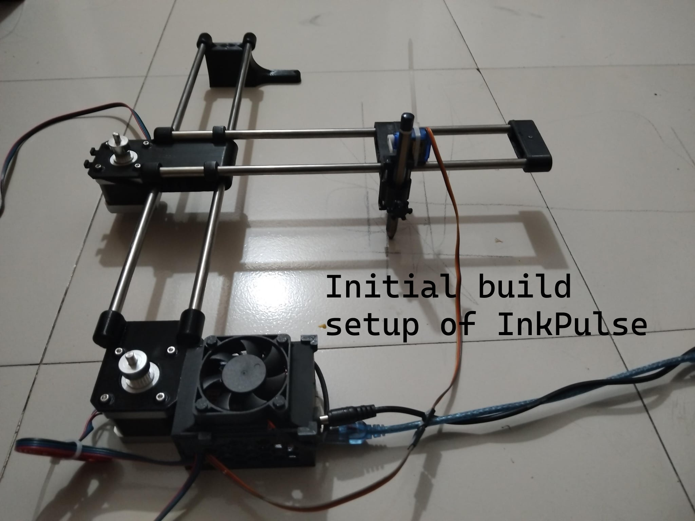
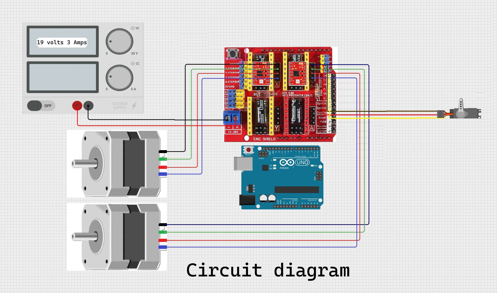

# InkPulse: CNC XY Plotter

**InkPulse** is a custom-built, low-cost, high-speed XY-plotter designed to draw vector artwork and write text in English with different kinds of font with good accuracy. Built from scratch without expensive linear bearings. This project pushes the limits of DIY hardware optimization through low-cost 3D printing mechanism and custom firmware.
---

## Key Features

* **Low Cost Engineering:** Replaced expensive LM8UU and LM8LUU linear bearings with custom 3D-printed friction-based rod guides, lowering construction costs significantly compared to typical DIY plotters.
* **Firmware  Remapping:** Custom GRBL-Servo 0.9i firmware running at 115200 Baud Rate, remapped directly at `cpu_map_atmega328p.h` level. Y-axis pins (Step: 4, Dir: 7) were swapped with Z-axis pins as here was a hardware issue in the arduino I used in this priject, (Step: 3, Dir: 6) to drive the pen lift via standard Z+ slot G-code commands (`M3 S13`/`M5 S40`).
* **High Speed & Acceleration:** Powered by a 19V 3.15A DC power supply and GT2 belt-drive system, tuned to achieve up to 8000 mm/min maximum feed rate and **500 mm/sec²** acceleration.

## Working Principle
There are 2 stepper motors that controls respectively X and Y axis. So the pen can go to anywhere in the grid. The servo  motor controls the z axis mechanism or pen lifting mechanism. The whole thing's brain is Arduino Uno. The CNC shield v3 sits on the top of Arduino. and 2 A4988 Stepper Drivers sit on the CNC shield completing the control unit. The servo is connected by 3 wires that is connected by a custom made bridge so that the wire can go wherever the pen moves. And a 12v DC motor connected with 19v with a resistor in series that cools the control unit where plenty heat is produced by A4988 Stepper Drivers.

## Softwares
The Inkpulse uses several software to operate. Firstly comes the Gcode part. The Gcode is written by Inkscape software. Inkscape creates a trace bitmap and it converts it into gcode. Then LaserGRBL sends those Gcode to the Inkpulse and it can write or draw smoothly.

---

## Hardware & Components List

| Component | Description |
| :--- | :--- |
| **Controller** | Arduino Uno R3 |
| **Shield** | CNC Shield V3 |
| **Drivers** | A4988 Stepper Drivers (1/16 microstepping) |
|**Motors** | Nema 17 45Ncm stepper motor|
| **Power Supply** | 19V 3.15A DC Adapter |
| **Pen Lift** | SG90 / MG90S Micro Servo Motor |
| **Drive System** | GT2 Belts & 20-Tooth Pulleys |
| **Structure** | Custom 3D Printed Rod Guides + Smooth Steel Rods |
| **Power Filter**| 1000uF Electrolytic Capacitor |
|**Others**| Cooling fan, holding parts(screw, zip tie) |

---

## 📷 Photos & Video Demonstration

### Project Build & Working Demo

🎬 **Watch Video Demo:** [Click here to view the plotter in action](WhatsApp%20Video%202026-10-04%20at%2010.53.54%20PM_squished.mp4)

## Repository Structure
* `/3D objects` All the 3d printable .3mf file

---

